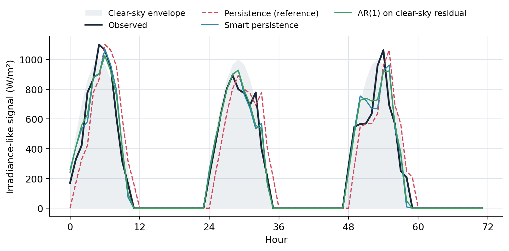
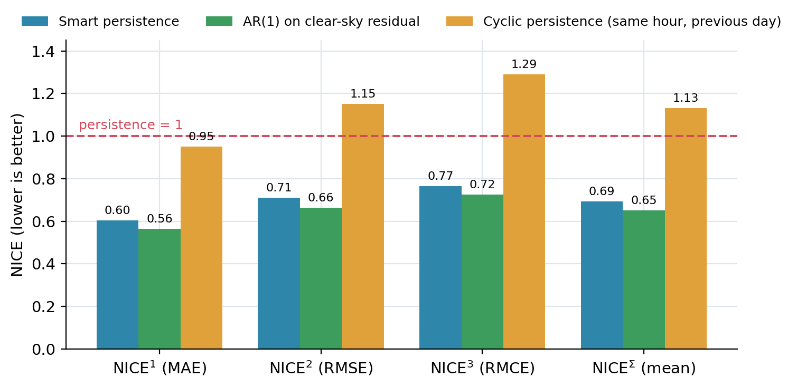
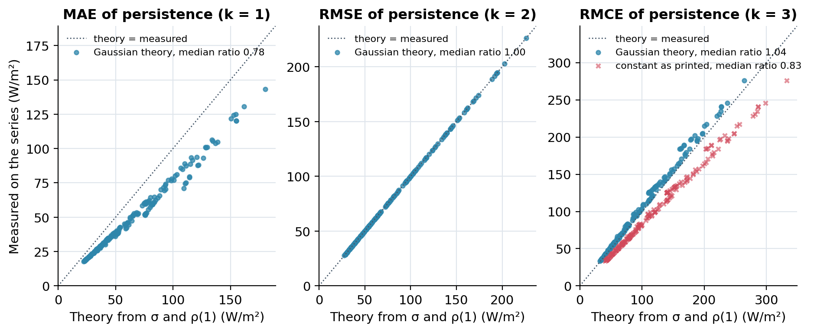

# nice-metrics

**NICEᵏ: normalised forecast errors that say how much better a model is than persistence.**
MATLAB code, a teaching demonstration with figures, and the scripts of the article:

> C. Voyant, M. Despotovic, L. Garcia-Gutierrez, R. Amaro e Silva, P. Lauret, T. Soubdhan, N. Bailek.
> *NICEᵏ metrics: Unified and multidimensional framework for evaluating deterministic solar forecasting accuracy.*
> Sustainable Energy Technologies and Assessments 83 (2025) 104588. [doi:10.1016/j.seta.2025.104588](https://doi.org/10.1016/j.seta.2025.104588) · [arXiv:2508.01457](https://arxiv.org/abs/2508.01457)

---

## Why another metric?

An RMSE of 80 W/m² is excellent on a cloudy Atlantic coast and poor in a desert. An R² of 0.81 looks good, yet in the demonstration below it is the R² of **simple persistence**, the forecast that just repeats the last value. Raw and percentage errors depend on the climate, the time step and the normalisation chosen; they do not say whether a model has learnt anything.

NICEᵏ answers one question: **what fraction of the error of persistence does the model keep?**

| NICEᵏ value | meaning |
|---|---|
| 0 | perfect forecast |
| 0.6 | the model keeps 60 % of the persistence error (it removes 40 %) |
| 1 | no better than persistence |
| > 1 | worse than persistence: the model should not be used as is |

## Definition

For observations y(t), forecasts ŷ(t) and n scored samples, the Lᵏ error is

$$E_k = \left(\frac{1}{n}\sum_{t=1}^{n} |y(t)-\hat y(t)|^k\right)^{1/k},$$

so E₁ is the MAE, E₂ the RMSE and E₃ the root mean cubic error (RMCE). Then

$$\mathrm{NICE}^k = \frac{E_k(\text{model})}{E_k(\text{persistence})}, \qquad \mathrm{NICE}^{\Sigma} = \tfrac13\left(\mathrm{NICE}^1+\mathrm{NICE}^2+\mathrm{NICE}^3\right).$$

Both errors are computed **on the same samples** (same dates, same horizon, same night filtering).

The exponent k decides which errors matter:

- **k = 1** (MAE) treats every error alike and is robust to a few outliers;
- **k = 2** (RMSE) penalises large errors more, and is the usual choice;
- **k = 3** (RMCE) is dominated by the largest errors: useful when a rare large miss is costly (reserve sizing, grid security).

A model can be good on average and bad on its worst hours. Reading the three values side by side shows it (see the cyclic persistence in Figure 2).

## Worked example by hand

Four hours of irradiance, the persistence forecast (previous hour) and a model:

| hour | observed y | persistence | error | model | error |
|---|---:|---:|---:|---:|---:|
| 2 | 500 | 400 | 100 | 460 | 40 |
| 3 | 450 | 500 | −50 | 480 | −30 |
| 4 | 600 | 450 | 150 | 560 | 40 |
| 5 | 550 | 600 | −50 | 580 | −30 |

| | persistence | model | NICEᵏ |
|---|---:|---:|---:|
| MAE (k = 1) | (100 + 50 + 150 + 50) / 4 = **87.5** | (40 + 30 + 40 + 30) / 4 = **35.0** | 35.0 / 87.5 = **0.40** |
| RMSE (k = 2) | √(37 500 / 4) = **96.8** | √(5 000 / 4) = **35.4** | **0.365** |
| RMCE (k = 3) | ∛(4 625 000 / 4) = **105.0** | ∛(182 000 / 4) = **35.7** | **0.34** |

NICE^Σ = (0.40 + 0.365 + 0.34) / 3 ≈ **0.37**: the model keeps about a third of the persistence error. NICE³ is the lowest because the model removes the 150 W/m² miss that dominates the cubic error of persistence. (Fictitious teaching values.)

```matlab
m = nice_metrics([500 450 600 550], [460 480 560 580], [400 500 450 600]);
[m.NICE1 m.NICE2 m.NICE3 m.NICE_Sigma]   % 0.400 0.365 0.340 0.368
```

## Link with the autocorrelation

For a weakly stationary series of standard deviation σ and lag-1 autocorrelation ρ(1), the persistence error D = y(t) − y(t−1) has variance

$$\sigma_D^2 = 2\sigma^2\,(1-\rho(1)).$$

So RMSE(persistence) = σ√(2(1−ρ(1))) exactly, whatever the distribution of D. **The more the series is autocorrelated, the harder persistence is to beat**, and NICE² measures a model against that difficulty. If D is also Gaussian:

$$E_1(P) = \sqrt{2/\pi}\;\sigma_D, \qquad E_3(P) = \left(\frac{2\sqrt2}{\sqrt\pi}\right)^{1/3}\sigma_D \approx 1.169\,\sigma_D .$$

Example: σ = 300 W/m², ρ(1) = 0.9 → σ_D = 134.2 W/m², MAE ≈ 107.0, RMSE = 134.2, RMCE ≈ 156.8 W/m².
`nice_theory_persistence(300, 0.9)` returns these values.

### Note on Eq. (B.5) of the article

Eq. (10) and Appendix B, Eqs. (B.5)–(B.7), of the article (checked on the author version, arXiv:2508.01457v1) write the third absolute moment of a centred Gaussian variable as E|D|³ = (4√2/√π) σ_D³. The correct value is **E|D|³ = (2√2/√π) σ_D³ ≈ 1.596 σ_D³** (a simulation of four million Gaussian draws gives 1.596). With the printed factor, the theoretical RMCE of persistence is 2^(1/3) ≈ 1.26 times too large (197.5 instead of 156.8 W/m² in the example above), so the *theoretical* NICE³ is about 21 % too low.

What this does **not** change: NICE¹, NICE², and every NICEᵏ computed from measured errors (the model's error divided by the measured error of persistence), which is how the metrics are used in practice. The code of this repository uses the correct constant; `nice_theory_persistence` also returns the value with the printed constant (`E3_article_constant`) for comparison. The original scripts in `paper_scripts/` are kept unchanged and still use the printed constant.

## Demonstration

```matlab
demo_nice            % MATLAB: writes results/*.csv (about 10 s)
```
```bash
python make_figures.py   # draws figures/*.png and *.pdf from those files
```

The signal is the synthetic generator of the article: a clear-sky-like daily cycle, 1000·max(0, sin(2πt/24)), multiplied by Gaussian noise of mean 1, bounded to [0.2, 1.1] and smoothed over three hours; 500 days, one-hour-ahead forecasts.



**Figure 1.** Three days of the signal. Persistence (dashed red) lags the observation by one hour; it is late on every rise and every fall of the daily cycle. Smart persistence corrects that lag with the clear-sky shape; the AR(1) model on the clear-sky residual also uses the correlation of the noise.

| model | nRMSE | R² | NICE¹ | NICE² | NICE³ | NICE^Σ |
|---|---:|---:|---:|---:|---:|---:|
| Persistence | 0.566 | 0.812 | 1 | 1 | 1 | 1 |
| Smart persistence | 0.402 | 0.905 | 0.605 | 0.710 | 0.766 | 0.694 |
| AR(1) on clear-sky residual | 0.375 | 0.917 | 0.564 | 0.663 | 0.725 | 0.651 |
| Cyclic persistence | 0.651 | 0.751 | 0.951 | 1.151 | 1.291 | 1.131 |



**Figure 2.** NICEᵏ of three models against persistence. Two lessons:

1. **R² flatters every model.** Persistence already has R² = 0.81 because the daily cycle is easy; NICE removes that free share and shows that the AR model keeps about two thirds of the persistence RMSE.
2. **The exponent k reveals the shape of the errors.** Cyclic persistence (same hour, previous day) is almost as good as persistence in MAE (0.95) but much worse in RMCE (1.29): it is usually close, and badly wrong when yesterday was clear and today is cloudy. A single score would hide this.



**Figure 3.** Errors of persistence measured on 200 synthetic series (random period and noise memory) against the theory from σ and ρ(1). The RMSE relation is exact (median ratio 1.00). The MAE and RMCE relations need D to be Gaussian; here D has many near-zero values at night, so the MAE is overestimated (ratio 0.78) and the RMCE slightly underestimated (1.04). With the constant printed in the article (red crosses), the RMCE theory is off by a factor 0.83. Take-away for practice: **compute NICE from measured persistence errors**; use the closed forms to understand, not to replace, the measurement.

Note: in this demonstration the AR(1) coefficients are fitted on the whole series, as in the article's synthetic study; for a real evaluation, fit on past data only and score on later data.

## Files

| file | role |
|---|---|
| `nice_metrics.m` | NICE¹, NICE², NICE³ and NICE^Σ of any forecast against persistence or any reference |
| `nice_theory_persistence.m` | theoretical MAE, RMSE and RMCE of persistence from σ and ρ (correct Gaussian constant) |
| `demo_nice.m` | the demonstration above; writes `results/*.csv` |
| `make_figures.py` | draws `figures/` from the CSV files (numpy, pandas, matplotlib) |
| `paper_scripts/` | the article's own MATLAB scripts, unchanged (SHA-256 in `paper_scripts_SHA256.txt`) |

About `paper_scripts/`: `main.m` calls `predict_PAR`, a periodic AR model available in [cyclostationary-forecasting-matlab](https://github.com/cyrilvoyant/cyclostationary-forecasting-matlab); `ViolinPlots.m` draws with `al_goodplot`, by Antoine Legouhy, available on MATLAB File Exchange and not redistributed here. Use `demo_nice.m` for a self-contained run.

Requirements: MATLAB R2021a or later (base MATLAB only for `nice_metrics`, `nice_theory_persistence` and `demo_nice`); Python 3 with numpy, pandas and matplotlib for the figures.

## Related

- Guide with more context: [cyrilvoyant.github.io/methods/nice-metrics.html](https://cyrilvoyant.github.io/methods/nice-metrics.html)
- NICE used in a full benchmark: [PV_ELM_pred](https://github.com/cyrilvoyant/PV_ELM_pred) and [cell-vs-field-irradiance](https://github.com/cyrilvoyant/cell-vs-field-irradiance)
- A complementary, tolerance-based score: [temporal-gamma-index](https://github.com/cyrilvoyant/temporal-gamma-index)
- Persistence references beyond simple persistence (BLEND, CLIPER): [cyclostationary-forecasting-matlab](https://github.com/cyrilvoyant/cyclostationary-forecasting-matlab)

## Citation and license

Please cite the article above (see `CITATION.cff`). Code under the MIT license.
